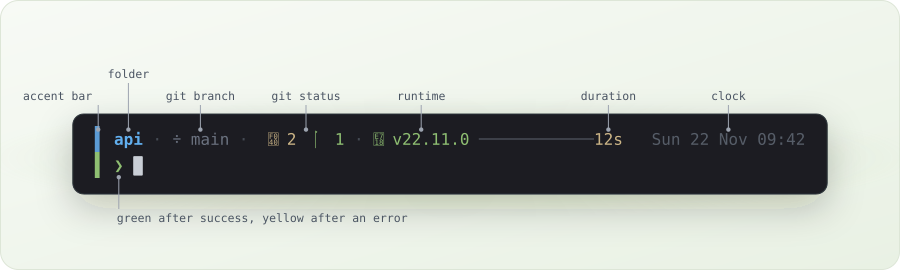
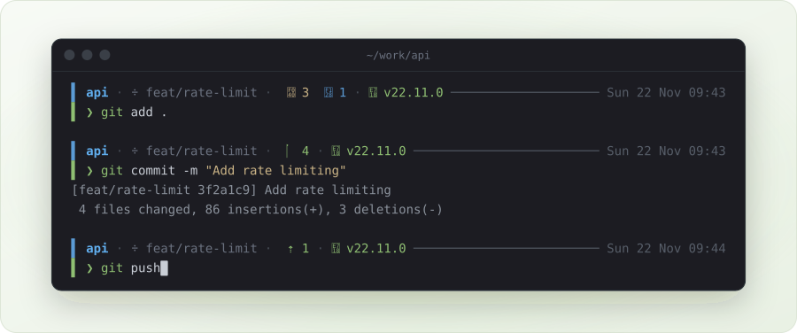
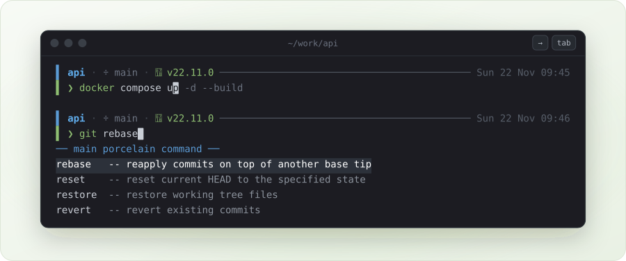
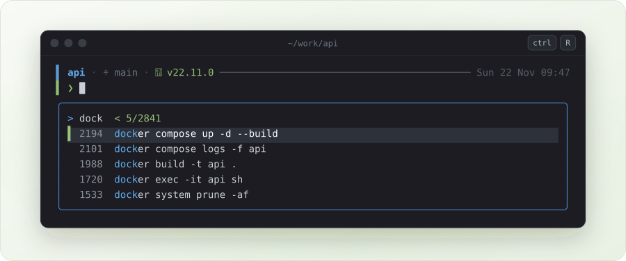
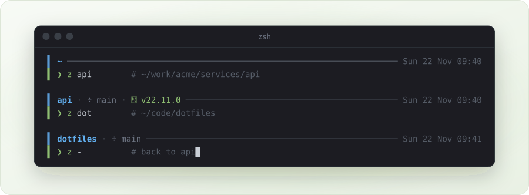
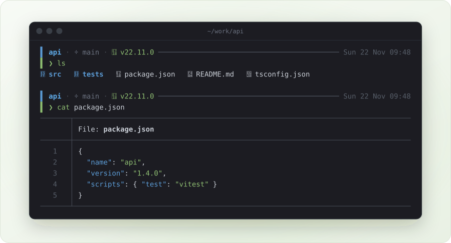
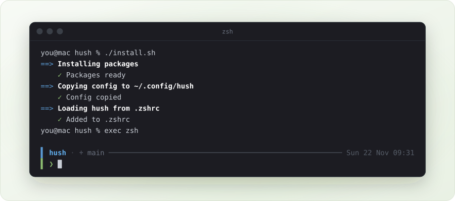

<div align="center">


# hush

**A quiet, minimal terminal for macOS.**

One command gives zsh a calm prompt, suggestions as you type, fuzzy search and better defaults.

[](#install)
[](config/hush.zsh)
[](config/starship.toml)
[](LICENSE)

[Features](#features) · [Install](#install) · [Customize](#customize) · [Uninstall](#uninstall)

</div>

## Features

### A prompt that stays quiet

Only the current folder is bright. Branch, changes, runtime and timing stay muted until you need them. The prompt never uses red: yellow marks anything that needs attention.

<picture>
  <source media="(prefers-color-scheme: dark)" srcset=".github/assets/prompt-dark.svg">
  
</picture>

### Git at a glance

See what changed, what is staged and what is waiting to be pushed, without typing `git status`.

<picture>
  <source media="(prefers-color-scheme: dark)" srcset=".github/assets/git-dark.svg">
  
</picture>

### Suggestions as you type

Gray hints come from your history. Press `→` to accept one. `Tab` opens a menu you can move through with the arrow keys.

<picture>
  <source media="(prefers-color-scheme: dark)" srcset=".github/assets/suggestions-dark.svg">
  
</picture>

### Find any past command

`Ctrl R` searches your history as you type. `Ctrl T` finds files and `⌥ C` jumps into folders the same way.

<picture>
  <source media="(prefers-color-scheme: dark)" srcset=".github/assets/fuzzy-dark.svg">
  
</picture>

### Jump to any project

`z` learns the folders you visit. Type part of a name to go straight there, from anywhere.

<picture>
  <source media="(prefers-color-scheme: dark)" srcset=".github/assets/jump-dark.svg">
  
</picture>

### Readable files

`ls` shows icons with folders first. `cat` adds syntax highlighting and line numbers.

<picture>
  <source media="(prefers-color-scheme: dark)" srcset=".github/assets/files-dark.svg">
  
</picture>

Every shortcut and alias is in the [cheatsheet](docs/cheatsheet.md).

## Install

You need macOS and [Homebrew](https://brew.sh).

```sh
git clone https://github.com/MeetJariwala10/hush.git
cd hush
./install.sh
```

<picture>
  <source media="(prefers-color-scheme: dark)" srcset=".github/assets/install-dark.svg">
  
</picture>

Last step: set your terminal font to **JetBrainsMono Nerd Font**, which the installer added, then open a new tab.

| Terminal | Where to set the font |
| --- | --- |
| Terminal.app | Settings > Profiles > Text > Font |
| iTerm2 | Settings > Profiles > Text > Font |
| Ghostty | Add `font-family = JetBrainsMono Nerd Font` to its config |
| VS Code | Already set by the installer |

<details>
<summary>What the installer changes</summary>

<br>

1. Installs the packages in the [Brewfile](Brewfile), skipping any you already have.
2. Copies `config/` to `~/.config/hush/`.
3. Adds one `source` line to `~/.zshrc`, between `# >>> hush >>>` markers.
4. Sets the VS Code terminal font, if VS Code is installed.

Every file is backed up before it changes, as `<file>.bak-<date>`. Your existing `~/.config/starship.toml` is not modified, but hush uses its own copy while installed.

</details>

## What's inside

| Tool | Role |
| --- | --- |
| [Starship](https://starship.rs) | Prompt |
| [zsh-autosuggestions](https://github.com/zsh-users/zsh-autosuggestions) | Suggestions as you type |
| [zsh-syntax-highlighting](https://github.com/zsh-users/zsh-syntax-highlighting) | Colors commands as you type |
| [fzf](https://github.com/junegunn/fzf) | Fuzzy finder |
| [zoxide](https://github.com/ajeetdsouza/zoxide) | Smarter `cd` |
| [eza](https://github.com/eza-community/eza) | Modern `ls` |
| [bat](https://github.com/sharkdp/bat) | `cat` with syntax highlighting |
| [JetBrains Mono Nerd Font](https://www.nerdfonts.com) | Font with icons |

## Customize

Your config lives in `~/.config/hush/`. Edit `starship.toml` for the prompt or `hush.zsh` for the shell, then run `reload`.

See [docs/customize.md](docs/customize.md) for common changes, the git status icons and the color palette.

## Uninstall

```sh
./uninstall.sh
```

This removes the hush lines from `~/.zshrc` and deletes `~/.config/hush`. If you edited your config, it is kept as `~/.config/hush.bak-<date>` instead. The VS Code font setting and Homebrew packages stay; the script prints the command to remove the packages.

## Troubleshooting

| Problem | Fix |
| --- | --- |
| Icons show as boxes | Set your terminal font to JetBrainsMono Nerd Font. |
| `⌥ C` types `ç` | Terminal.app: Settings > Profiles > Keyboard > Use Option as Meta key. |
| Prompt has not changed | Open a new tab, or run `exec zsh`. |
| `command not found: brew` | Install [Homebrew](https://brew.sh), then run `./install.sh` again. |

## Contributing

Issues and pull requests are welcome. Please keep changes minimal and calm, and use no red.

The images in this README are generated by [`.github/assets/render.py`](.github/assets/render.py). Run it after changing the prompt so they stay accurate.

## Credits

hush configures the tools above and does not include their code; each keeps its own license.
The README images embed a subset of [JetBrains Mono](https://github.com/JetBrains/JetBrainsMono)
([SIL OFL 1.1](.github/assets/OFL.txt)), reduced to the characters each image uses and patched by [Nerd Fonts](https://www.nerdfonts.com), with icons from
[Font Awesome](https://fontawesome.com) ([CC BY 4.0](https://creativecommons.org/licenses/by/4.0/)) and
[Devicons](https://github.com/vorillaz/devicons) (MIT).

## License

[MIT](LICENSE)
